<p align="center">
  
</p>

[](https://github.com/krishi-shah/dailybugbounties/actions/workflows/daily.yml)
[](data/bounties.json)
[](data/bounties.json)
[](LICENSE)

**Every paid open source issue in one list. Newest first, updated every 12 hours.**

Daily Bug Bounties collects open bounties from **Algora**, **IssueHunt**, **Opire**, **Expensify**, **Ubiquity DevPool**, **TaskBounty**, **Superteam Earn** and GitHub issues that carry a bounty label or a bounty in the title, plus security bug bounties and audit contests from **Immunefi** and **Sherlock**. It checks that each issue is still open, removes spam, and lists what's left newest first.

📡 **RSS:** [`docs/feed.xml`](docs/feed.xml) for new bounties as they appear
🧾 **JSON:** [`data/bounties.json`](data/bounties.json) if you want to build on it

⭐ Star the repo to keep it handy. It refreshes itself every 12 hours.

## Today's top bounties

<!-- FEED:START -->
**42 open bounties worth $21,455** · 0 new today · 30 with nobody trying yet · updated 2026-11-19 14:31 UTC

**Sources:** DevPool 39 · Superteam 2 · Label 1 · Title 1  
**Pays via:** Crypto wallet 41 · Ask maintainer 1 · **✅ Verified payers:** 37  
**Languages:** TypeScript 31 · Solidity 2 · Shell 1 · JavaScript 1

### 🆕 Latest bounties

Newest first. 🆕 marks bounties that showed up today. ✅ marks repos that have paid bounties before. **Tries** counts `/attempt` and `/claim` comments; **PRs** counts open pull requests that would close the issue.

| Payout | Issue | Repo | ★ | Lang | Source · pays via | Tries | PRs | Age |
|---:|---|---|---:|---|---|---:|---:|---:|
| **$75** | [Apply the health-check deadline to response decoding](https://github.com/ubiquity/stake.ubq.fi/issues/45) | [ubiquity/stake.ubq.fi](https://github.com/ubiquity/stake.ubq.fi) ✅ | 1 | TypeScript | DevPool · Crypto wallet | 0 |  | 48d |
| **$75** | [Dismiss reverted-receipt toasts when the status clears](https://github.com/ubiquity/stake.ubq.fi/issues/44) | [ubiquity/stake.ubq.fi](https://github.com/ubiquity/stake.ubq.fi) ✅ | 1 | TypeScript | DevPool · Crypto wallet | 0 |  | 48d |
| **$75** | [Resolve the selected RPC when each request is made](https://github.com/ubiquity/stake.ubq.fi/issues/43) | [ubiquity/stake.ubq.fi](https://github.com/ubiquity/stake.ubq.fi) ✅ | 1 | TypeScript | DevPool · Crypto wallet | 0 |  | 48d |
| **$75** | [Pass transport factories to viem's fallback](https://github.com/ubiquity/stake.ubq.fi/issues/42) | [ubiquity/stake.ubq.fi](https://github.com/ubiquity/stake.ubq.fi) ✅ | 1 | TypeScript | DevPool · Crypto wallet | 0 |  | 48d |
| **$75** | [Keep HTTP diagnostic Boolean parsing consistent for n](https://github.com/ubiquity/permit2-rpc-manager/issues/31) | [ubiquity/permit2-rpc-manager](https://github.com/ubiquity/permit2-rpc-manager) ✅ | 0 | TypeScript | DevPool · Crypto wallet | 0 | 1 | 32d |
| **$18** | [Enable JavaScript inputs in the JSX lint recipe](https://github.com/ubiquity/ts-template/issues/106) | [ubiquity/ts-template](https://github.com/ubiquity/ts-template) ✅ | 1 | TypeScript | DevPool · Crypto wallet | 0 |  | 48d |
| **$27** | [Bulk permit deletion copy claims bogus-only scope while the action invalidates e…](https://github.com/ubiquity/pay.ubq.fi/issues/500) | [ubiquity/pay.ubq.fi](https://github.com/ubiquity/pay.ubq.fi) ✅ | 10 | TypeScript | DevPool · Crypto wallet | 0 |  | 48d |
| **$150** | [Preserve token selector holdings and amount labels across inventory refreshes](https://github.com/ubiquity/uusd.ubq.fi/issues/92) | [ubiquity/uusd.ubq.fi](https://github.com/ubiquity/uusd.ubq.fi) ✅ | 0 | TypeScript | DevPool · Crypto wallet | 0 | 1 | 58d |
| **$75** | [Preserve explicit repository choice and title edits in the proposal router](https://github.com/ubiquity/.github/issues/137) | [ubiquity/.github](https://github.com/ubiquity/.github) ✅ | 3 | TypeScript | DevPool · Crypto wallet | 0 |  | 58d |
| **$75** | [Honor no-transform and strip modern digest headers when rewriting HTML](https://github.com/ubiquity/ubq.fi-router/issues/37) | [ubiquity/ubq.fi-router](https://github.com/ubiquity/ubq.fi-router) ✅ | 1 | TypeScript | DevPool · Crypto wallet | 0 |  | 58d |
| **$10** | [Frantic bounty #97: Your first bounty is on the house ($10 back when it clears, …](https://github.com/auscaster/frantic-board/issues/277) | [auscaster/frantic-board](https://github.com/auscaster/frantic-board) | 1,065 | Shell | Label, Title · Ask maintainer | 2 | 4 | 134d |
| **$75** | [Reminder is sent on PR reopening even with no assignee](https://github.com/ubiquity-os-marketplace/daemon-disqualifier/issues/135) | [ubiquity-os-marketplace/daemon-disqualifier](https://github.com/ubiquity-os-marketplace/daemon-disqualifier) ✅ | 1 | TypeScript | DevPool · Crypto wallet | 0 |  | 218d |
| **$75** | [CoWSwap Integration Improvements](https://github.com/ubiquity/uusd.ubq.fi/issues/47) | [ubiquity/uusd.ubq.fi](https://github.com/ubiquity/uusd.ubq.fi) ✅ | 0 | TypeScript | DevPool · Crypto wallet | 0 | 1 | 226d |
| **$1,800** | [UbiquityOS Sprint Management Dashboard](https://github.com/ubiquity-os/.github/issues/14) | [ubiquity-os/.github](https://github.com/ubiquity-os/.github) ✅ | 0 |  | DevPool · Crypto wallet | 1 |  | 337d |
| **$450** | [Plugin health monitor](https://github.com/ubiquity-os/.github/issues/12) | [ubiquity-os/.github](https://github.com/ubiquity-os/.github) ✅ | 0 |  | DevPool · Crypto wallet | 1 | 2 | 354d |
| **$600** | [command-plan](https://github.com/ubiquity-os/plugins-wishlist/issues/78) | [ubiquity-os/plugins-wishlist](https://github.com/ubiquity-os/plugins-wishlist) ✅ | 0 |  | DevPool · Crypto wallet | 0 |  | 1y |
| **$450** | [Automatically set a `Time: ` label](https://github.com/ubiquity-os/plugins-wishlist/issues/76) | [ubiquity-os/plugins-wishlist](https://github.com/ubiquity-os/plugins-wishlist) ✅ | 0 |  | DevPool · Crypto wallet | 1 |  | 1y |
| **$37.50** | [Phase 3: Update database types and improve type safety](https://github.com/ubiquity/pay.ubq.fi/issues/433) | [ubiquity/pay.ubq.fi](https://github.com/ubiquity/pay.ubq.fi) ✅ | 10 | TypeScript | DevPool · Crypto wallet | 0 |  | 1y |
| **$150** | [Nudge to claim DEMO currency](https://github.com/ubiquity-os/command-demo/issues/15) | [ubiquity-os/command-demo](https://github.com/ubiquity-os/command-demo) ✅ | 0 | TypeScript | DevPool · Crypto wallet | 1 |  | 1y |
| **$900** | [DevPool Directory Matchmaking UI](https://github.com/devpool-directory/devpool-directory-tasks/issues/63) | [devpool-directory/devpool-directory-tasks](https://github.com/devpool-directory/devpool-directory-tasks) ✅ | 1 |  | DevPool · Crypto wallet | 1 |  | 1y |
| **$900** | [Nomic Embeddings Model for +10% Accuracy](https://github.com/ubiquity-os-marketplace/text-vector-embeddings/issues/111) | [ubiquity-os-marketplace/text-vector-embeddings](https://github.com/ubiquity-os-marketplace/text-vector-embeddings) ✅ | 0 | TypeScript | DevPool · Crypto wallet | 0 |  | 1y |
| **$400** | [Multi Chain Arbitrage](https://github.com/ubiquity/arbitrage-bot/issues/7) | [ubiquity/arbitrage-bot](https://github.com/ubiquity/arbitrage-bot) | 0 | TypeScript | DevPool · Crypto wallet | 0 | 1 | 1y |
| **$1,200** | [Integrate Liquity V1 Stability Pool for LUSD Collateral Yield](https://github.com/ubiquity/ubiquity-dollar/issues/997) | [ubiquity/ubiquity-dollar](https://github.com/ubiquity/ubiquity-dollar) ✅ | 40 | Solidity | DevPool · Crypto wallet | 0 |  | 1y |
| **$1,200** | [GitHub Decoupling](https://github.com/ubiquity-os-marketplace/text-conversation-rewards/issues/385) | [ubiquity-os-marketplace/text-conversation-rewards](https://github.com/ubiquity-os-marketplace/text-conversation-rewards) ✅ | 3 | TypeScript | DevPool · Crypto wallet | 0 |  | 1y |
| **$600** | [Specialized Prompts](https://github.com/ubiquity-os-marketplace/text-conversation-rewards/issues/340) | [ubiquity-os-marketplace/text-conversation-rewards](https://github.com/ubiquity-os-marketplace/text-conversation-rewards) ✅ | 3 | TypeScript | DevPool · Crypto wallet | 0 |  | 1y |
| **$225** | [Retry and token limits](https://github.com/ubiquity-os-marketplace/text-conversation-rewards/issues/330) | [ubiquity-os-marketplace/text-conversation-rewards](https://github.com/ubiquity-os-marketplace/text-conversation-rewards) ✅ | 3 | TypeScript | DevPool · Crypto wallet | 0 |  | 1y |
| **$75** | [Multiple Matchmaking Comments](https://github.com/ubiquity-os-marketplace/text-vector-embeddings/issues/94) | [ubiquity-os-marketplace/text-vector-embeddings](https://github.com/ubiquity-os-marketplace/text-vector-embeddings) ✅ | 0 | TypeScript | DevPool · Crypto wallet | 0 |  | 1y |
| **$300** | [premade configs that are hands-off for partners](https://github.com/ubiquity-os/ubiquity-os-plugin-installer/issues/43) | [ubiquity-os/ubiquity-os-plugin-installer](https://github.com/ubiquity-os/ubiquity-os-plugin-installer) ✅ | 0 | TypeScript | DevPool · Crypto wallet | 0 |  | 1y |
| **$600** | [Implement Differential Reward Distribution for Reopened Issues](https://github.com/ubiquity-os-marketplace/text-conversation-rewards/issues/301) | [ubiquity-os-marketplace/text-conversation-rewards](https://github.com/ubiquity-os-marketplace/text-conversation-rewards) ✅ | 3 | TypeScript | DevPool · Crypto wallet | 0 |  | 1y |
| **$300** | [Callbacks - event handlers and hybrid plugins](https://github.com/ubiquity-os/ubiquity-os-kernel/issues/261) | [ubiquity-os/ubiquity-os-kernel](https://github.com/ubiquity-os/ubiquity-os-kernel) ✅ | 4 | TypeScript | DevPool · Crypto wallet | 0 |  | 1y |
| **$75** | [March 2025 Adjustments](https://github.com/ubiquity-os-marketplace/text-vector-embeddings/issues/92) | [ubiquity-os-marketplace/text-vector-embeddings](https://github.com/ubiquity-os-marketplace/text-vector-embeddings) ✅ | 0 | TypeScript | DevPool · Crypto wallet | 0 |  | 1y |
| **$600** | [Unified Authentication](https://github.com/ubiquity/.github/issues/124) | [ubiquity/.github](https://github.com/ubiquity/.github) ✅ | 3 | TypeScript | DevPool · Crypto wallet | 0 |  | 1y |
| **$300** | [New Proposal Router](https://github.com/ubiquity/.github/issues/123) | [ubiquity/.github](https://github.com/ubiquity/.github) ✅ | 3 | TypeScript | DevPool · Crypto wallet | 0 |  | 1y |
| **$600** | [Cow Swap Cash Out](https://github.com/ubiquity/pay.ubq.fi/issues/386) | [ubiquity/pay.ubq.fi](https://github.com/ubiquity/pay.ubq.fi) ✅ | 10 | TypeScript | DevPool · Crypto wallet | 0 |  | 1y |
| **$50** | [Test ubiquity-os](https://github.com/ondecentral/Lucia-SDK-Experimental/issues/17) | [ondecentral/Lucia-SDK-Experimental](https://github.com/ondecentral/Lucia-SDK-Experimental) | 0 | JavaScript | DevPool · Crypto wallet | 1 | 1 | 1y |
| **$450** | [Review Incentive Double Check Calculations](https://github.com/ubiquity-os-marketplace/text-conversation-rewards/issues/260) | [ubiquity-os-marketplace/text-conversation-rewards](https://github.com/ubiquity-os-marketplace/text-conversation-rewards) ✅ | 3 | TypeScript | DevPool · Crypto wallet | 0 |  | 1y |
| **$2,400** | [Add `UUSD` and `UBQ` tokens to popular services](https://github.com/ubiquity/ubiquity-dollar/issues/984) | [ubiquity/ubiquity-dollar](https://github.com/ubiquity/ubiquity-dollar) ✅ | 40 | Solidity | DevPool · Crypto wallet | 0 | 1 | 1y |
| **$37.50** | [Set `organization/repository` names in the plugins' configs](https://github.com/ubiquity-os/ubiquity-os-plugin-installer/issues/39) | [ubiquity-os/ubiquity-os-plugin-installer](https://github.com/ubiquity-os/ubiquity-os-plugin-installer) ✅ | 0 | TypeScript | DevPool · Crypto wallet | 0 |  | 1y |
| **$75** | [Improve Task Assignment Limit Handling](https://github.com/ubiquity-os-marketplace/command-start-stop/issues/106) | [ubiquity-os-marketplace/command-start-stop](https://github.com/ubiquity-os-marketplace/command-start-stop) ✅ | 1 | TypeScript | DevPool · Crypto wallet | 0 |  | 1y |
| **$300** | [Improving Recommendations](https://github.com/ubiquity-os-marketplace/text-vector-embeddings/issues/55) | [ubiquity-os-marketplace/text-vector-embeddings](https://github.com/ubiquity-os-marketplace/text-vector-embeddings) ✅ | 0 | TypeScript | DevPool · Crypto wallet | 0 |  | 1y |
| **$5,000** | [MultiHopper Build & Route Challenge \| Up to $50,000 + Revenue Share](https://superteam.fun/earn/listing/multihopper-build-and-route-challenge-up-to-dollar50000-revenue-share-1/) | [MultiHopper](https://superteam.fun/earn/s/multihopper/) |  |  | Superteam · Crypto wallet | 80 sub |  | due 25d |
| **$500** | [Build an Autonomous Capital Agent on Solana & Compete for $500 in Rewards](https://superteam.fun/earn/listing/build-an-autonomous-capital-agent-on-solana-and-compete-for-dollar500-in-rewards/) | [OOBE Protocol](https://superteam.fun/earn/s/oobeprotocol/) |  |  | Superteam · Crypto wallet | 22 sub |  | due 21d |

Plus 52 older bounties on issues opened more than two years ago and 3 crowded ones with 10 or more PRs and attempts already: see [`data/bounties.json`](data/bounties.json).

### 💰 Biggest payouts right now

| Payout | Issue | Repo | ★ | Lang | Source · pays via | Tries | PRs | Age |
|---:|---|---|---:|---|---|---:|---:|---:|
| **$5,000** | [MultiHopper Build & Route Challenge \| Up to $50,000 + Revenue Share](https://superteam.fun/earn/listing/multihopper-build-and-route-challenge-up-to-dollar50000-revenue-share-1/) | [MultiHopper](https://superteam.fun/earn/s/multihopper/) |  |  | Superteam · Crypto wallet | 80 sub |  | due 25d |
| **$2,400** | [Add `UUSD` and `UBQ` tokens to popular services](https://github.com/ubiquity/ubiquity-dollar/issues/984) | [ubiquity/ubiquity-dollar](https://github.com/ubiquity/ubiquity-dollar) ✅ | 40 | Solidity | DevPool · Crypto wallet | 0 | 1 | 1y |
| **$1,800** | [UbiquityOS Sprint Management Dashboard](https://github.com/ubiquity-os/.github/issues/14) | [ubiquity-os/.github](https://github.com/ubiquity-os/.github) ✅ | 0 |  | DevPool · Crypto wallet | 1 |  | 337d |
| **$1,200** | [Integrate Liquity V1 Stability Pool for LUSD Collateral Yield](https://github.com/ubiquity/ubiquity-dollar/issues/997) | [ubiquity/ubiquity-dollar](https://github.com/ubiquity/ubiquity-dollar) ✅ | 40 | Solidity | DevPool · Crypto wallet | 0 |  | 1y |
| **$1,200** | [GitHub Decoupling](https://github.com/ubiquity-os-marketplace/text-conversation-rewards/issues/385) | [ubiquity-os-marketplace/text-conversation-rewards](https://github.com/ubiquity-os-marketplace/text-conversation-rewards) ✅ | 3 | TypeScript | DevPool · Crypto wallet | 0 |  | 1y |
| **$900** | [DevPool Directory Matchmaking UI](https://github.com/devpool-directory/devpool-directory-tasks/issues/63) | [devpool-directory/devpool-directory-tasks](https://github.com/devpool-directory/devpool-directory-tasks) ✅ | 1 |  | DevPool · Crypto wallet | 1 |  | 1y |
| **$900** | [Nomic Embeddings Model for +10% Accuracy](https://github.com/ubiquity-os-marketplace/text-vector-embeddings/issues/111) | [ubiquity-os-marketplace/text-vector-embeddings](https://github.com/ubiquity-os-marketplace/text-vector-embeddings) ✅ | 0 | TypeScript | DevPool · Crypto wallet | 0 |  | 1y |
| **$600** | [command-plan](https://github.com/ubiquity-os/plugins-wishlist/issues/78) | [ubiquity-os/plugins-wishlist](https://github.com/ubiquity-os/plugins-wishlist) ✅ | 0 |  | DevPool · Crypto wallet | 0 |  | 1y |
| **$600** | [Specialized Prompts](https://github.com/ubiquity-os-marketplace/text-conversation-rewards/issues/340) | [ubiquity-os-marketplace/text-conversation-rewards](https://github.com/ubiquity-os-marketplace/text-conversation-rewards) ✅ | 3 | TypeScript | DevPool · Crypto wallet | 0 |  | 1y |
| **$600** | [Implement Differential Reward Distribution for Reopened Issues](https://github.com/ubiquity-os-marketplace/text-conversation-rewards/issues/301) | [ubiquity-os-marketplace/text-conversation-rewards](https://github.com/ubiquity-os-marketplace/text-conversation-rewards) ✅ | 3 | TypeScript | DevPool · Crypto wallet | 0 |  | 1y |

### 🛡️ Security bug bounties

Find a real vulnerability, get paid. These aren't fixed price tasks: programs pay **up to** their max for a valid report, and audit contests split a prize pool between researchers. Most pay in USDC and many need KYC.

**Top bug bounty programs** (144 live on Immunefi, biggest first)

| Up to | Program | Stack | KYC |
|---:|---|---|:---:|
| **$10,000,000** | [Sky](https://immunefi.com/bug-bounty/sky/) | Solidity | no |
| **$6,000,000** | [USDT0](https://immunefi.com/bug-bounty/usdt0/) | Typescript, Solidity | yes |
| **$5,000,000** | [GMX](https://immunefi.com/bug-bounty/gmx/) | JavaScript, Solidity, Typescript | no |
| **$5,000,000** | [Spark](https://immunefi.com/bug-bounty/sparklend/) |  | no |
| **$3,500,000** | [Stargate](https://immunefi.com/bug-bounty/stargate/) | Solidity | yes |
| **$3,500,000** | [LayerZero](https://immunefi.com/bug-bounty/layerzero/) | Solidity, Rust, Move | yes |
| **$3,333,333** | [Olympus](https://immunefi.com/bug-bounty/olympus/) | Solidity | no |
| **$3,000,000** | [Chainlink](https://immunefi.com/bug-bounty/chainlink/) | Go, Rust, Solidity | yes |
| **$3,000,000** | [Ethena](https://immunefi.com/bug-bounty/ethena/) |  | yes |
| **$2,500,000** | [Hyperlane](https://immunefi.com/bug-bounty/hyperlane/) | NextJS, Solidity | yes |
| **$2,000,042** | [Optimism](https://immunefi.com/bug-bounty/optimism/) | C/C++, Go, Solidity | yes |
| **$2,000,000** | [Gnosis Chain](https://immunefi.com/bug-bounty/gnosischain/) | Solidity | no |
| **$2,000,000** | [Arbitrum](https://immunefi.com/bug-bounty/arbitrum/) | Solidity | yes |
| **$2,000,000** | [Rhino.fi](https://immunefi.com/bug-bounty/rhinofi/) | Solidity | no |
| **$2,000,000** | [Lido](https://immunefi.com/bug-bounty/lido/) | Solidity, Vyper | no |
<!-- FEED:END -->

## How it works

| Source | How we get it | Where the amount comes from |
|---|---|---|
| Opire | Public `api.opire.dev/rewards` endpoint | Opire's reward value |
| Algora | GitHub search for the `💎 Bounty` label | The Algora bot comment on the issue |
| IssueHunt | GitHub search for the "Funded on IssueHunt" labels | The funded total IssueHunt writes into the issue |
| Expensify | Open `Help Wanted` issues in `Expensify/App` | The price in the title, like `[$250]` |
| DevPool | Open tasks in Ubiquity's `devpool-directory`, mapped back to the original issue | The `Price: 75 USD` label |
| TaskBounty | Public `task-bounty.com/api/v1/tasks` endpoint | The funded amount |
| Labeled | GitHub search for `bounty` and 9 similar labels | A `$` amount in a label, the title or the body |
| Title | GitHub search for issues with "bounty" in the title | A `$` amount in the title only |
| Immunefi | Public `bounties.json` catalog of bug bounty programs and audit competitions | The program's max bounty (shown separately as "up to") |
| Sherlock | Public contests API, live contests only | The contest prize pool |
| Superteam Earn | Public listings API (bounties and projects) | The reward, when paid in a dollar stablecoin (USDC, USDG). Only dev work is kept: content gigs like threads and videos are filtered out by title |

Then, every 12 hours in GitHub Actions:

Bounties from boards like Superteam Earn aren't GitHub issues, so they skip the GitHub checks. They link to the listing page, show the sponsor instead of a repo, and drop off once their deadline passes.


1. **Merge.** If one issue shows up on two platforms, it becomes one row. We keep the higher amount and never add the two together.
2. **Verify.** For GitHub issues, one GraphQL call for every 25 issues gets the open/closed state, repo stars, language, archive status, the `/attempt` and `/claim` comments, and any open pull requests that would close the issue.
3. **Filter.** We drop closed issues, issues already assigned to someone, issues where a solution was already claimed, locked issues, issues labeled rewarded, in progress, on hold and similar, archived repos, amounts under $10 or over $50k, and prompt injection bait. We drop any repo under 10 stars (company run programs like Expensify and DevPool are exempt), payouts of $500 or more in repos under 100 stars, and $5k or more under 200 stars. We also drop bounties paid in tokens or points instead of cash, airdrop style scams, issues with no activity for a year (6 months for generic labels), issue farms, and anything in [`blocklist.txt`](blocklist.txt).
4. **Order.** Bounties on issues opened more than two years ago, or with 10 or more open PRs and attempts, are hidden by default: they're old or effectively taken. Everything else is newest first: bounties found today sit at the top, then by when the issue was opened. Each repo keeps at most its 5 best paying bounties (Expensify is exempt, since it really pays for every one).
5. **Publish.** The run writes this README, the JSON, the RSS feed and the site data, and commits them if anything changed.

No paid APIs, no accounts, no dependencies. It uses Python's standard library and the built in `GITHUB_TOKEN`.

## How you get paid

Every bounty shows how it pays and whether the repo has paid before.

| Pays via | Sources | What you need |
|---|---|---|
| Stripe | Algora, Opire | A Stripe account for payouts. Claim with `/claim #<issue>` in your PR |
| Upwork | Expensify | A verified Upwork profile linked in your GitHub bio, and an accepted proposal before you code |
| Crypto wallet | DevPool, Superteam Earn, TaskBounty | A wallet address registered with the platform. Some Superteam listings need KYC |
| IssueHunt | IssueHunt | An IssueHunt account |
| Ask maintainer | Bounty labels and titles | Read the issue. The maintainer decides how and when to pay |

**✅ Verified payer** means we've seen this repo pay bounties before: Algora's `💰 Rewarded` label, DevPool tasks closed as completed, or issues marked `paid` or `rewarded`. Expensify is marked verified because it pays every accepted fix through Upwork. The evidence builds up over time in [`data/payers.json`](data/payers.json).

## Run it yourself

```bash
git clone https://github.com/krishi-shah/dailybugbounties && cd dailybugbounties
export GITHUB_TOKEN=ghp_...        # any token works; without one, verification is skipped
python -m dailybugbounties --root .      # writes README.md, data/, docs/
python -m dailybugbounties --sources opire,algora -v
python -m unittest discover -s tests
```

You can tune the filters with environment variables: `BB_MIN_AMOUNT`, `BB_MAX_AMOUNT`, `BB_MIN_STARS_LABELED`, `BB_PER_REPO_CAP`, `BB_SEARCH_MAX_RESULTS`. See [`dailybugbounties/config.py`](dailybugbounties/config.py).

## Contributing

* **Found spam or a fake payout?** Open a PR that adds the repo or owner to [`blocklist.txt`](blocklist.txt), with a link that shows why.
* **Know another bounty platform?** Add a module under `dailybugbounties/sources/` that returns `Bounty` objects, then add a test.
* **Found a security issue in this repo?** See [SECURITY.md](SECURITY.md).
* **Amount parsed wrong?** Add the text to `tests/test_feed.py` and fix `dailybugbounties/money.py`.

## Before you start work on a bounty

Amounts come from each platform or from the issue text. Read the issue, check that the bounty is still active, and see who is already working on it. dailybugbounties is a discovery tool and has no connection to any of these platforms.

## License

MIT
